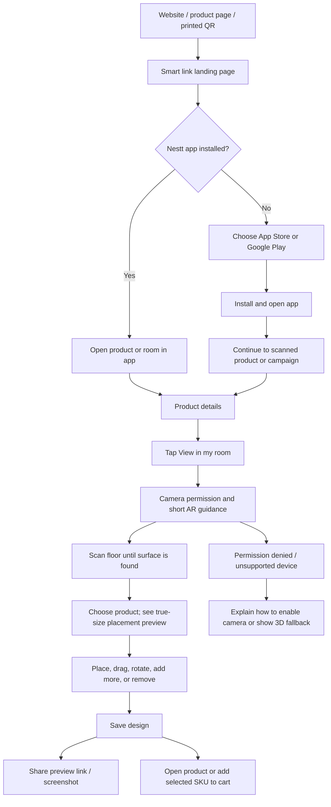

# Nestt Room AR App — Product Requirements

**Status:** Draft for product and engineering review  
**Prepared:** 2 November 2026  
**Scope:** Customer flow, MVP requirements, analytics, UX, and engineering

## 1. Product objective

Help furniture shoppers judge the size, style, and fit of a Nestt product in their own room before buying. The customer scans a QR code from the website, product page, or campaign; installs or opens the Nestt app; and uses the phone camera to arrange real-scale furniture in AR, then saves or shares the design.

### Success measures

- Increase product-page-to-cart conversion for customers who use AR.
- Reduce uncertainty about product scale and room fit.
- Measure QR-to-app-open, AR placement, design save/share, and purchase funnels.
- Compare assisted conversion and return rates between AR users and a suitable non-AR cohort.

Do not set numeric targets until a baseline and first-device prototype are measured.

## 2. Customer journey

### Entry behavior

- **Product page:** QR and “View in my room” point to the exact SKU/variant.
- **Desktop website:** QR opens a smart link. If the app is installed, open that product in the app; otherwise show the correct store buttons and preserve the source/product context for first launch where supported.
- **Campaign or room QR:** open the app’s room-design start screen, optionally with a curated product set.
- **App already open:** open the product directly; do not show a second install screen.
- **QR install limitation:** the QR routes to the App Store/Google Play or a landing page; it cannot silently install an iPhone/Android app. On iPhone, a PWA can be added from Safari to the Home Screen, but that is a different, lighter experience.

## 3. MVP user experience

### Main screens

1. **Smart-link landing page** — Nestt branding, app-installed/open state, store buttons, product/campaign context, and web 3D fallback.
2. **App product detail** — real product photos, dimensions, variants, price, stock, “View in my room,” and standard add-to-cart action.
3. **AR onboarding** — one-time, short instructions; request camera permission only when the customer starts AR.
4. **AR room view** — live camera, floor-detection guidance, loading/error state, product tray, close, undo, save, and help controls.
5. **Selected-item controls** — selected product name, rotate, move, remove, and product details. Furniture stays at catalog dimensions by default; avoid free scaling that misrepresents product size.
6. **Saved design** — product list, room screenshot, share, edit in AR, and product/cart links.
7. **Share preview** — opens on web without requiring the recipient to install the app; show the saved layout image, products, dimensions, and links to view/install the app.

### AR interaction rules

- Guide the customer to slowly move the phone until a usable floor plane is detected.
- Show a placement preview at real-world product scale before committing.
- Tap to place the first item; select and drag an existing item to reposition it on the detected floor.
- Rotate with a two-finger twist or a clear rotate control. Keep the camera orbit gesture separate from object manipulation.
- Let customers add multiple products, select one, move, rotate, duplicate if supported, or remove it.
- Prevent placement outside detected floor bounds where available. Warn on overlaps; do not silently block a valid creative layout.
- Provide a no-AR fallback: interactive 3D product view, dimensions, and supported-device/help information.
- Use tracked shadows and depth occlusion when supported; degrade gracefully on devices without depth sensing.

## 4. Functional requirements

| ID | Priority | Requirement |
|---|---|---|
| FR-01 | P0 | Smart QR link identifies its source and target product/campaign, and routes to app or correct store. |
| FR-02 | P0 | App deep link opens the intended SKU/variant; first launch has a fallback if deferred routing is unavailable. |
| FR-03 | P0 | App checks device AR support and presents a useful fallback instead of a broken camera screen. |
| FR-04 | P0 | Camera permission is requested at AR entry; denial explains how to continue or change permission. |
| FR-05 | P0 | Customer can detect a floor, place one real-scale product, and keep it visually stable while walking around. |
| FR-06 | P0 | Customer can add multiple products, select, drag, rotate, and remove them in the same session. |
| FR-07 | P0 | Each AR asset maps to a Nestt SKU/variant and contains validated dimensions, placement type, thumbnail, and asset version. |
| FR-08 | P0 | Customer can save a design and reopen it on the same account/device. Guest designs can be saved locally and upgraded to account-backed designs. |
| FR-09 | P0 | Customer can create a share link and screenshot; recipient sees a web preview and relevant product links. |
| FR-10 | P0 | Customer can move from an AR item to its exact product detail/cart SKU. |
| FR-11 | P1 | Collision/clearance hints indicate likely overlap or insufficient floor area. |
| FR-12 | P1 | Design can be restored in the same physical room with platform-supported anchors, subject to tracking and permissions. |
| FR-13 | P2 | Two customers can view a shared design anchored in the same physical room in real time. |
| FR-14 | P2 | Room scan can produce a reusable room outline/mesh; LiDAR-only features are optional enhancements, not an MVP dependency. |

## 5. Analytics plan

### Funnel events

`qr_landing_view` → `store_redirect` → `app_first_open` → `product_view` → `ar_session_start` → `surface_detected` → `ar_item_added` → `ar_item_placed` → `ar_item_moved` / `ar_item_rotated` → `design_saved` → `share_link_created` / `share_opened` → `add_to_cart` → `purchase`.

Track source/campaign, product ID, app version, platform, supported-device status, model load time, and error category. Use an anonymous session identifier before sign-in; join to account analytics only under Nestt’s consent policy.

### Core KPIs

- QR landing → store click and install/open rate.
- App first open → first successful AR placement rate.
- AR start → surface-detected rate and time to first placement.
- AR placement → save/share rate.
- AR assisted add-to-cart and purchase conversion, compared with a baseline cohort.
- AR asset load failures, session crashes, and unsupported-device fallback rate.
- Product return/cancellation rate for AR-assisted orders, where order data permits.

Do **not** send camera frames, room photos, precise room coordinates, or raw AR maps to analytics. Upload a room screenshot only after the customer explicitly chooses to save/share it.

## 6. Engineering direction

### Recommended architecture

- **Mobile:** Bare React Native CLI with TypeScript for shared product UI, navigation, catalogue, design editor controls, and account/cart flows. Do not use Expo; ViroReact requires native iOS and Android project linking.
- **AR renderer:** Use `@reactvision/react-viro` (ViroReact) for native ARKit and ARCore surfaces, GLB rendering, plane detection, and object manipulation. Keep its manually linked native layer behind the room-design UI so it can be replaced with native RealityKit/ARKit and Android ARCore modules if device validation reveals capability or performance gaps.
- **Native integration:** Treat camera session, surface hit tests, anchors, and per-frame rendering as native AR responsibilities. React Native owns normal app UI and communicates deliberate scene changes (add/move/rotate/remove/save) to the AR layer; do not stream camera frames through JavaScript.
- **Website:** Next.js remains the product discovery, QR landing, and share-preview surface. The current browser planner can remain a prototype, but it is not the mobile live-camera AR deliverable.
- **Backend:** existing NestJS API provides product/SKU data, AR asset metadata, saved designs, and share links. Do not duplicate pricing, stock, or cart rules in Unity.
- **Assets:** replace demo GLBs with SKU-accurate models. Validate dimensions, origin, pivot, orientation, materials, texture size, polygon count, and license. Stream compressed, versioned assets from a CDN; load on demand and cache on device. Validate the chosen AR renderer's GLB/glTF support and keep a conversion path for platform-ready formats if needed.
- **Design model:** store SKU/variant, scale lock, rotation, and transform relative to a room/session origin; keep platform anchor data separate and versioned. Store a screenshot separately from camera tracking data.
- **Deep links:** use one HTTPS smart-link domain and app links/universal links. Add deferred deep-link or first-open recovery so a scanned product survives the store-install step.
- **Sharing:** P0 share is a saved design preview and screenshot. Same-room cross-device AR alignment is a later feature and needs shared anchors/session lifecycle; a URL alone cannot reproduce a room’s physical coordinate system on another phone.

### Suggested API contracts

- `GET /ar/catalog` — AR-ready products, variants, model URLs, dimensions, placement and capability metadata.
- `POST /ar/designs` — save product placements and optional customer-approved screenshot.
- `GET /ar/designs/:shareId` — read-only share preview data.
- `PATCH /ar/designs/:id` — update an owned saved design.
- Reuse existing catalog/cart endpoints for price, stock, and checkout.

### Non-functional requirements

- Validate current AR support on a representative Android and iPhone device matrix before launch; unsupported phones get a 3D fallback.
- Maintain a stable 30 FPS minimum target on agreed mid-range AR-supported test devices; measure before setting final launch gates.
- Keep furniture at real scale and handle unit conversion consistently (catalog dimensions in mm; AR world units in meters).
- Show progress, retry, and fallback for model download/session errors; never leave the customer on a blank camera screen.
- Minimize camera and spatial data retention; obtain clear consent for any saved/shared room image or spatial map.
- Test install/open/deep-link behavior from QR on clean install, existing install, app closed, and app already open.

## 7. Acceptance criteria for MVP

1. Scanning a product QR on desktop and mobile reaches the matching product context; app-installed and not-installed paths both work.
2. On supported Android and iPhone devices, the customer can detect a floor and place a SKU-accurate product at catalog dimensions.
3. A customer can place at least three different items in one room, move and rotate them, and see them remain stable while moving the phone.
4. A saved design can be reopened; a shared link opens the intended web preview without requiring camera access.
5. The design’s product links resolve to the correct variant and cart item.
6. Permission denial, unsupported hardware, model-load failure, and network loss each have a usable recovery/fallback state.
7. Analytics captures the defined funnel without collecting camera images or exact room coordinates by default.

## 8. Delivery phases

1. **React Native and AR foundation:** create raw React Native CLI builds; validate manually linked ViroReact, product QR deep link, floor placement, and drag/rotate on one supported Android and one iPhone.
2. **MVP app and AR:** product selection, multi-item placement, drag/rotate/remove, local save, screenshot, web share preview, analytics, and fallback states in the shared React Native app.
3. **Store beta:** Android internal/closed testing and Apple TestFlight; resolve tracking, thermal, performance, and device compatibility issues.
4. **Public launch:** store listings, QR campaign rollout, support content, analytics dashboard, and conversion/return-rate review.
5. **Advanced:** same-room shared anchors, room scanning, collision/clearance assistance, and more SKU assets.

## 9. Key dependencies and decisions

- Accurate Nestt product 3D assets and final SKU dimensions are the critical-path dependency.
- Confirm public app distribution accounts and who owns store submissions.
- Decide whether guest designs can be saved only on device or require account sign-in.
- Agree the share privacy defaults and retention period before saving customer room images/maps.
- Define initial supported-device list from real testing, not from AR capability claims alone.

## 10. Platform references

- [Google ARCore hit tests and surface placement](https://developers.google.com/ar/develop/hit-test)
- [Google ARCore anchors and shared anchors](https://developers.google.com/ar/develop/anchors)
- [Google ARCore supported devices](https://developers.google.com/ar/devices/)
- [Apple ARKit object placement and interaction](https://developer.apple.com/documentation/arkit/placing-objects-and-handling-3d-interaction)
- [Apple RealityKit anchors](https://developer.apple.com/documentation/realitykit/scene-content-anchors)
- [React Native Turbo Native Modules](https://reactnative.dev/docs/turbo-native-modules-introduction)
- [ReactVision ViroReact project and ARKit/ARCore support](https://github.com/ReactVision/viro)
- [ReactVision ViroReact installation for bare React Native (no Expo)](https://viro-community.readme.io/docs/integrating-viroreact-with-react-native-no-expo)
- [Apple: add a website to the Home Screen as a web app](https://support.apple.com/guide/iphone/open-as-web-app-iphea86e5236/27/ios/27)
- [Apple TestFlight](https://developer.apple.com/testflight/)
